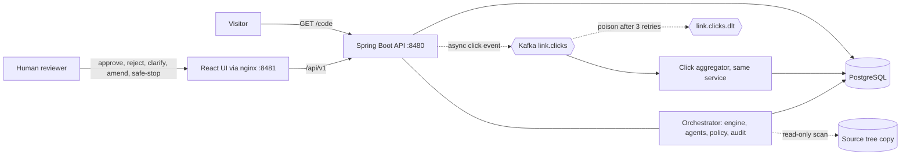
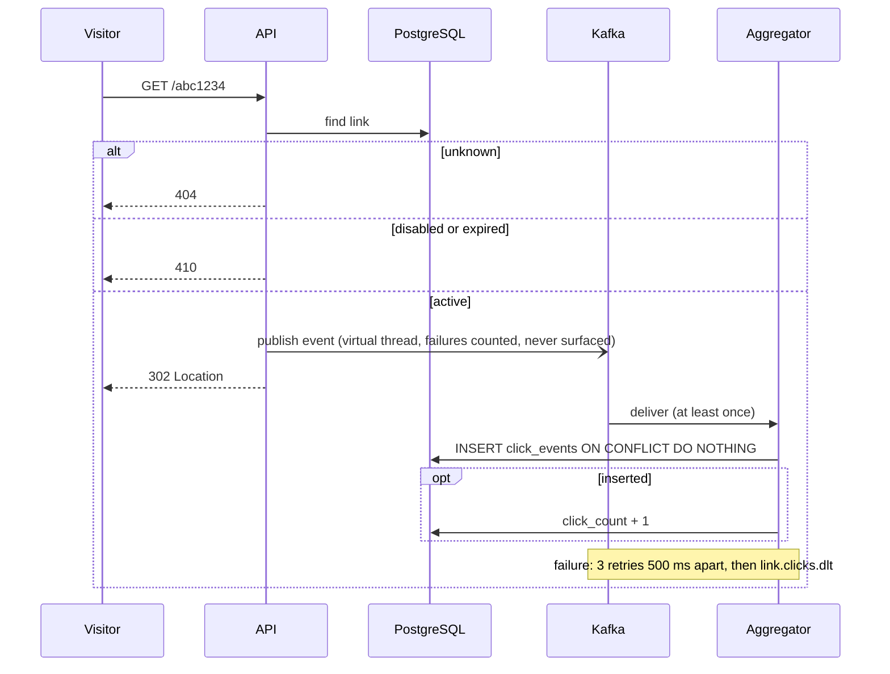
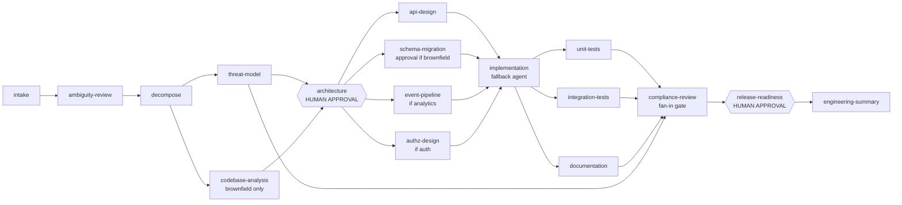
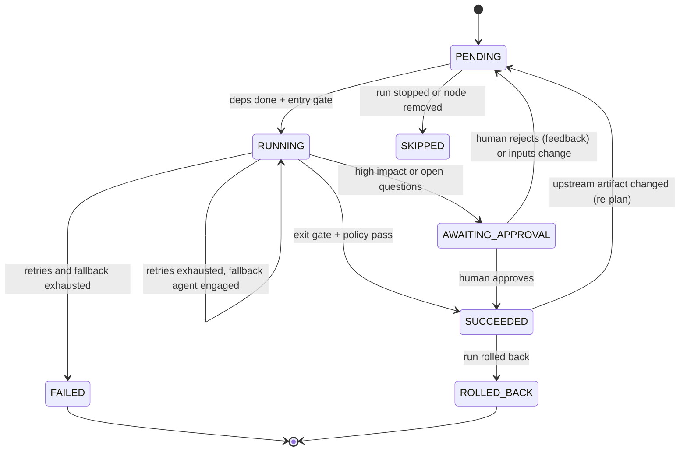
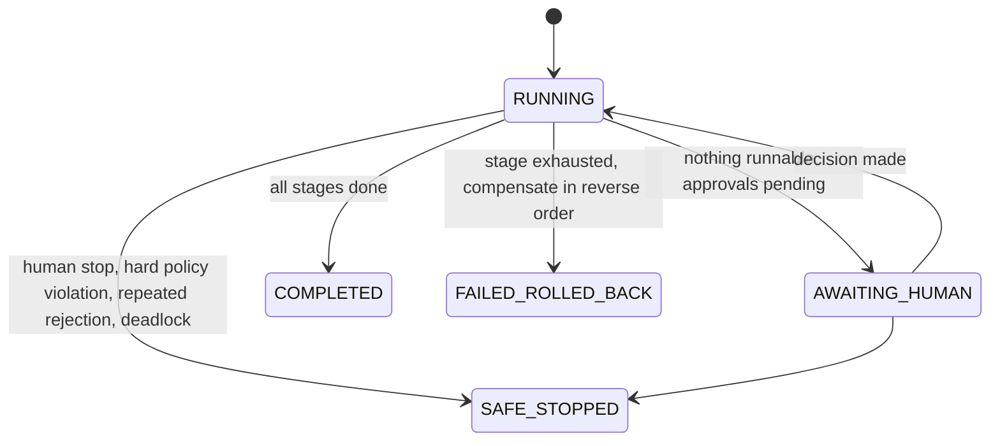
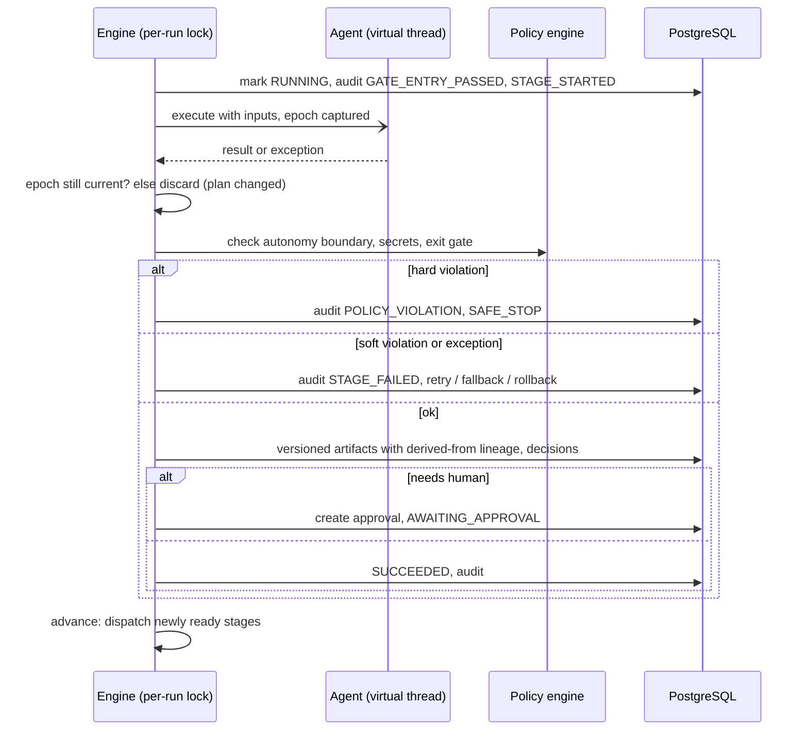
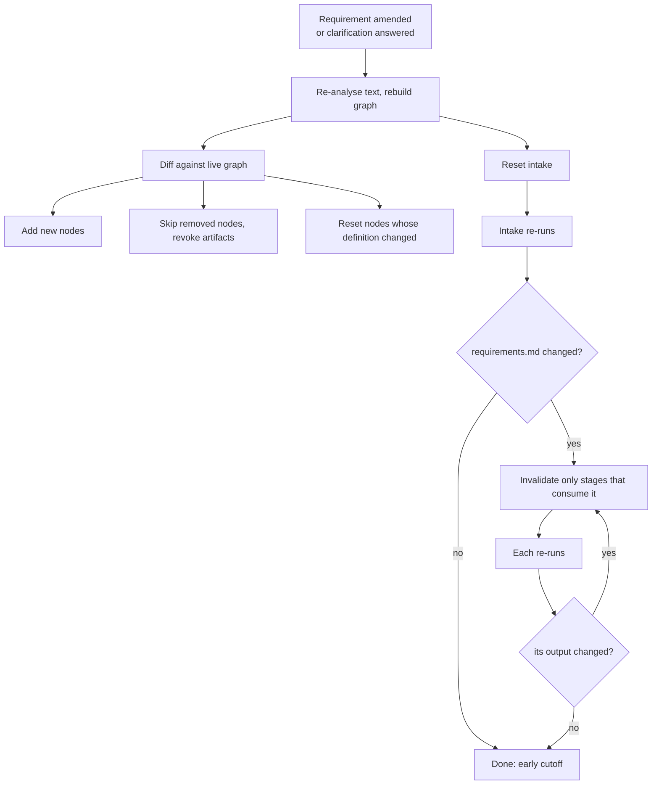
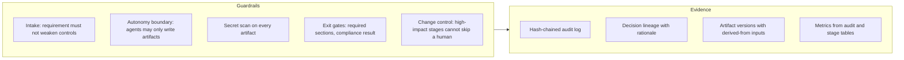
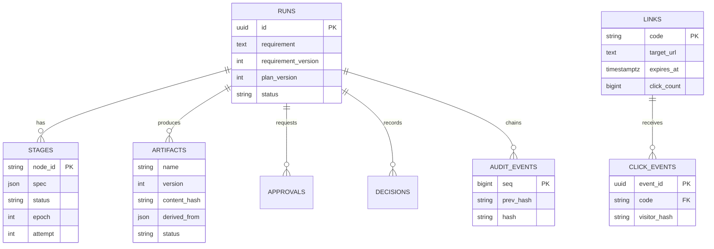

# Architecture

Diagrams are Mermaid and render on GitHub and most editors.

## 1. System context

One deployable (modular monolith) with three packages: `shortener`, `analytics`, `orchestrator`. The redirect path and the analytics path are decoupled by Kafka; the orchestrator is tooling and shares only the database.

## 2. Redirect and click analytics

The event id primary key is the idempotency barrier, so redelivery cannot double count. Raw IPs never leave the request: only a truncated one-way hash is carried.

## 3. Orchestration model

A requirement becomes an explicit dependency graph. Nodes run when all dependencies have succeeded, so independent branches run in parallel and fan-in nodes synchronize. The graph depends on the requirement: extra capabilities add nodes, brownfield adds codebase analysis.

Each node declares what it **consumes** and **produces**. Entry gate: every consumed artifact must be active. Exit gate: every produced artifact must exist, be non-empty and contain its required sections; the policy engine also checks the result.

### Stage lifecycle

### Run lifecycle

## 4. Control flow of one stage

Agent work runs outside the lock; state transitions run inside it and inside one database transaction. Because state is durable, a restart re-queues in-flight stages (`RECOVERED` event).

## 5. Re-planning on change

Early cutoff (as in build systems) is what keeps re-plans cheap: a stage whose regenerated output is byte-identical keeps its dependents, and an approved design that does not change is not sent back for approval (`APPROVAL_REUSED`). A changed design always needs a new approval.

## 6. Governance and observability

| Guardrail | Rule | Severity | Effect |
|---|---|---|---|
| CHG-003 | Requirement asks to disable auth, skip review, auto-deploy | HARD | Run safe-stopped before any agent runs |
| CHG-002 | Agent action outside declared capabilities (for example `DEPLOY_PRODUCTION`) | HARD | Safe-stop, output not committed |
| SEC-001 | Secret-like text in an artifact | HARD | Safe-stop |
| GATE-001..004 | Missing output, empty, missing section, failed compliance report | SOFT | Stage fails, retried with feedback |
| COMP-001, SEC-004 | Personal data without retention; no unsafe-target handling in design | SOFT | Stage fails, retried |
| CHG-001 | High-impact node needs human approval | structural | Enforced by the engine, cannot be configured away by an agent |

**Audit chain.** Each event stores `hash = SHA-256(prev_hash | run | time | actor | type | stage | payload)`. Editing, removing or reordering any event breaks verification from that point (`GET /runs/{id}/audit/verify`, tested by altering a row).

**Metrics** (`GET /metrics`): success rate (completed over finished runs), retries, fallbacks, rollback count and rate, re-plans, policy violations, human decisions, **MTTR** (first failure to eventual success of the same stage), **end-to-end latency** average and p95, agent-active versus human-wait time, and per-stage timings.

## 7. Data model

## 8. Key decisions and trade-offs

| Decision | Why | Trade-off |
|---|---|---|
| Modular monolith | One deployable, fastest to run and review | Orchestrator and product share a process and database |
| State in PostgreSQL, not memory | Survives restarts, powers audit and metrics, enables recovery | More writes; a per-run lock serializes transitions |
| Per-run lock + epoch counter | Simple correctness for parallel stages and re-plans: stale results are discarded | Throughput per run limited to the lock, fine for tens of stages |
| Deterministic agents behind an interface | Reproducible, testable, no secrets or network; guardrails apply the same to any future LLM agent | Outputs are templated, not creative; limited to catalogued capabilities |
| Early cutoff on artifact hashes | Re-plans rebuild only what actually changed | Needs byte-stable agent output |
| Soft vs hard policy | Fixable gaps retry; boundary breaches stop the run | Thresholds (such as clarification at 2 open questions) are judgement calls |
| 302 redirect | Clicks observable, expiry immediate | More load than cacheable 301 |
| Best-effort click publishing | Redirect availability beats analytics completeness | Events lost while the broker is down (counted in `shortener.click.publish.failed`) |
| In-memory rate limiter | No extra infrastructure | Per instance; move to Redis when scaled out |
